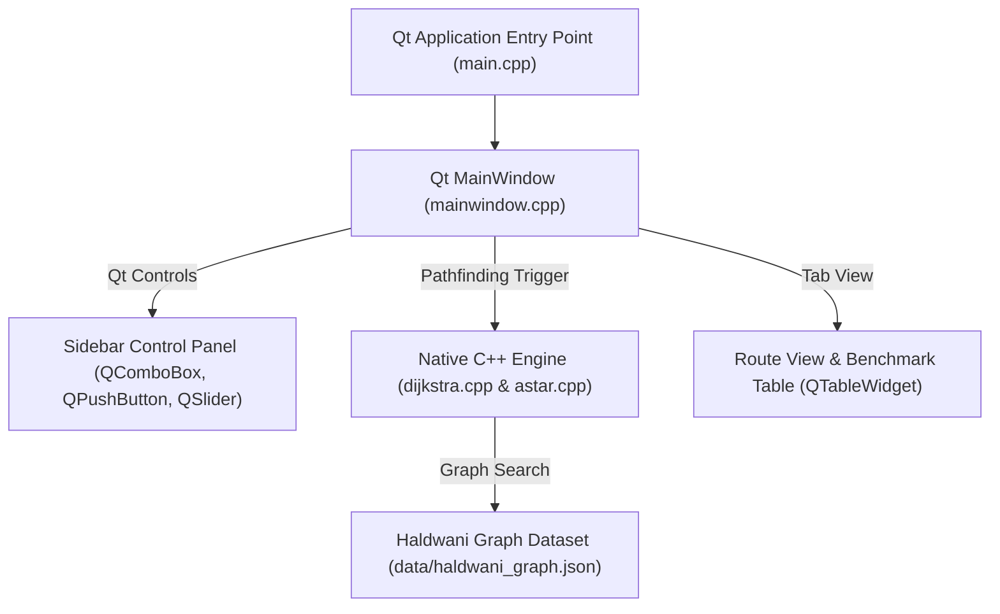

# AlgoRoute: Qt 6 Desktop Architecture Specification

**Project Title**: AlgoRoute - Optimal Route Finder (Qt 6 C++ Desktop GUI Application)  
**Target Area**: Haldwani & Kathgodam Municipal Region, Uttarakhand, India  
**Framework**: Qt 6.11.1 (`C:\Qt\6.11.1\mingw_64`), MinGW GCC 13.1.0  
**Core Subject**: Data Structures and Algorithms (DSA) / Graph Theory & Pathfinding  

---

## 1. High-Level Qt Desktop Architecture

---

## 2. Component Breakdown

### A. Qt MainWindow & GUI Controls (`src/mainwindow.h` & `src/mainwindow.cpp`)
- **Dark QSS Style**: Sleek desktop dark theme configured via Qt stylesheet.
- **Sidebar Controls**:
  - `QComboBox`: Searchable location autocompletion for Haldwani landmarks.
  - `QPushButton`: Route calculation, visualization, comparison, swap, and reset.
  - `QSlider`: Adjustable speed multiplier.
- **Central Tab Widget (`QTabWidget`)**:
  - **Tab 1**: Haldwani Route View (`QTextBrowser` & `QListWidget`).
  - **Tab 2**: Benchmark Table (`QTableWidget`).
  - **Tab 3**: DSA Documentation (`QTextBrowser`).

### B. Core Native C++ Engine (`src/`)
- `graph.cpp`: Loads 6,816 nodes and 12,571 edges, computes Haversine distances.
- `dijkstra.cpp`: Min-Priority Queue Dijkstra's algorithm.
- `astar.cpp`: Min-Priority Queue A* search algorithm with Haversine distance heuristic.
